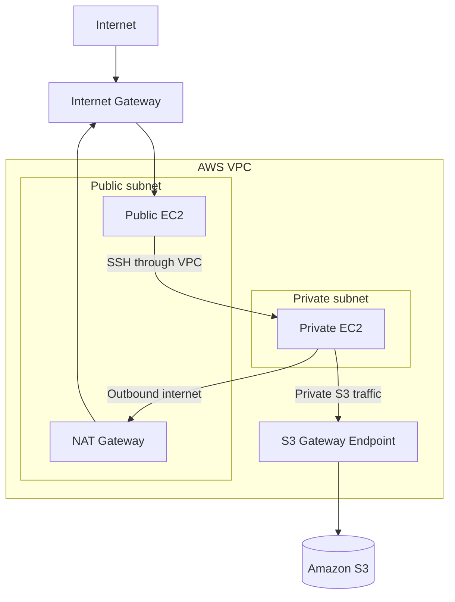
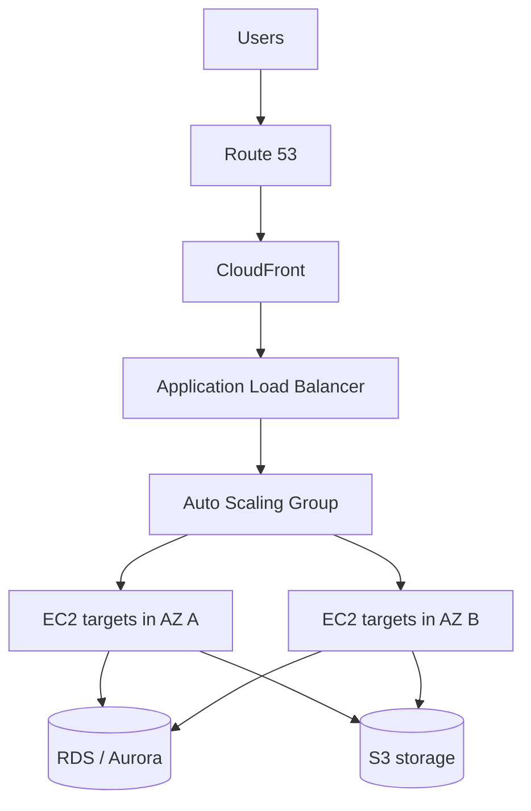
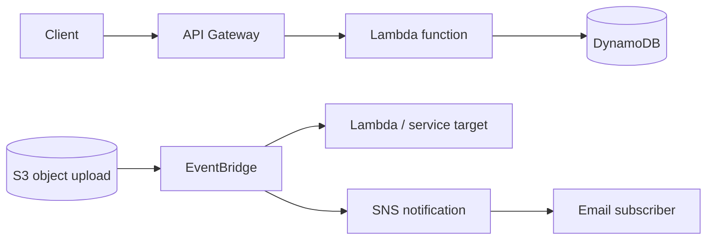
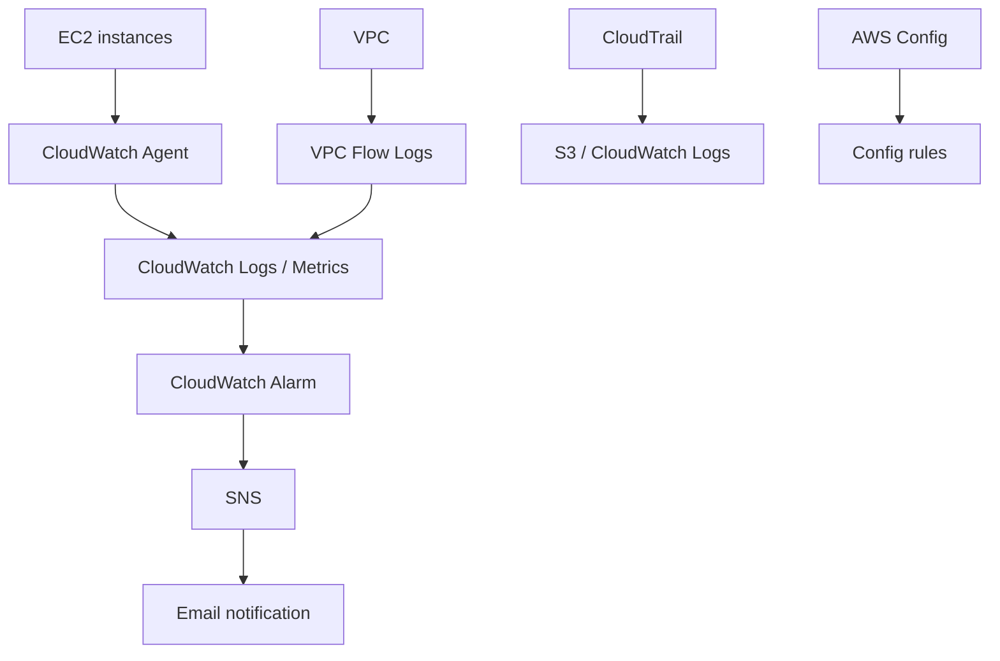
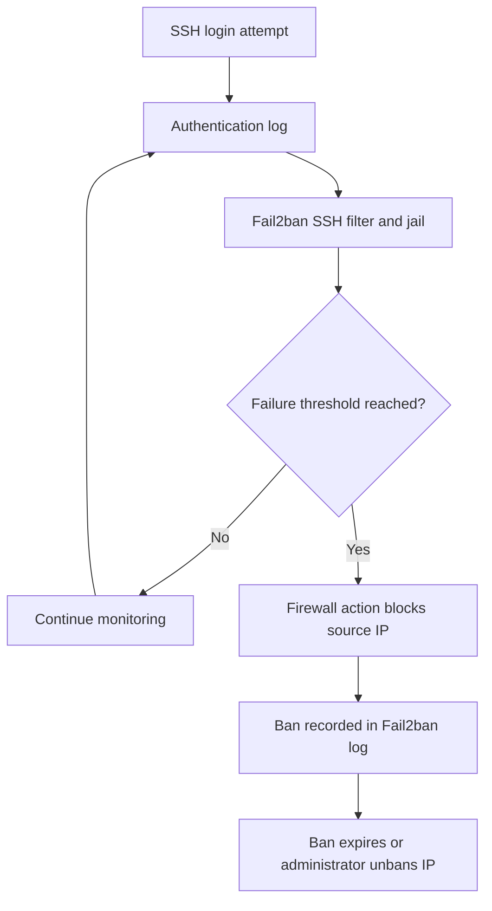
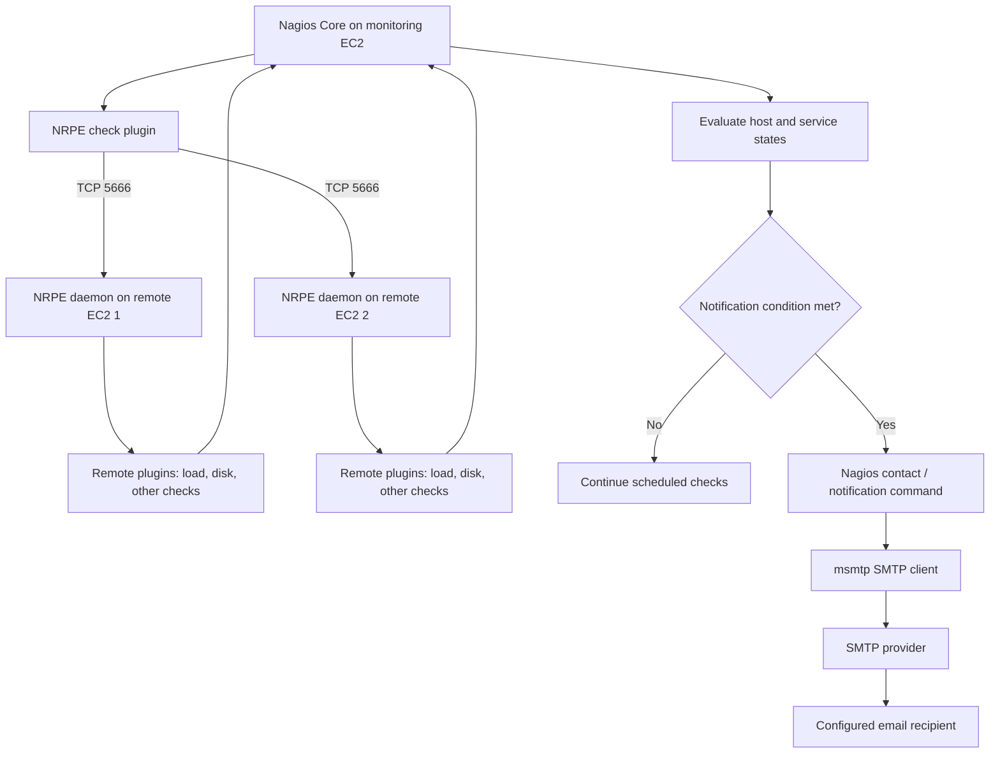

# AWS SAA-C03 Learning & Practical Documentation


**Course:** [New AWS Certified Solutions Architect Associate (SAA-C03) – Udemy](https://www.udemy.com/course/new-aws-certified-solutions-architect-associate-saa-c03/)

**Purpose:** A concise record of the main AWS concepts studied and the practical exercises recorded in my course notes (Days 2–27, assignment and daily update).

> This document summarizes personal learning notes. Practical items below are included where the notes record a lab, configuration or test. It is not a claim that every AWS service or SAA-C03 exam objective has been mastered.

## Contents

- [1. Main AWS Topics](#1-main-aws-topics)
  - [Cloud and IAM](#cloud-and-iam)
  - [Compute and Containers](#compute-and-containers)
  - [Networking and Content Delivery](#networking-and-content-delivery)
  - [Storage and Databases](#storage-and-databases)
  - [High Availability, Scaling and Recovery](#high-availability-scaling-and-recovery)
  - [Serverless and Application Integration](#serverless-and-application-integration)
  - [Security, Monitoring and Governance](#security-monitoring-and-governance)
  - [Infrastructure, Migration and Cost](#infrastructure-migration-and-cost)
- [2. Practical Exercises Recorded](#2-practical-exercises-recorded)
- [3. Key Architecture Flowcharts](#3-key-architecture-flowcharts)
- [4. Learning Summary](#4-learning-summary)
- [5. Document Scope](#5-document-scope)
- [6. Additional EC2 Security and Monitoring Implementation](#6-additional-ec2-security-and-monitoring-implementation)

---

## 1. Main AWS Topics

### Cloud and IAM

- **Cloud fundamentals:** Physical servers, virtual machines, containers, cloud service models and AWS Shared Responsibility Model.
- **IAM:** Users, groups, roles, identity-based and resource-based policies, managed/inline policies, trust policies, MFA and temporary credentials through AWS STS.
- **Governance:** AWS Organizations, Organizational Units, Service Control Policies (SCPs) and IAM Identity Center.
- **Core principle:** IAM policies define permissions; an explicit deny overrides an allow. Roles provide temporary credentials and should be preferred over long-lived access keys where applicable.

### Compute and Containers

- **EC2:** AMIs, instance families/sizes, user data, key pairs, security groups, IAM instance roles, instance metadata, ENIs and placement groups.
- **EC2 storage:** EBS volumes, volume types, IOPS/throughput, snapshots, encryption and instance store.
- **Pricing models:** On-Demand, Spot, Reserved Instances and Savings Plans.
- **Containers:** Docker, Amazon ECR, ECS, EKS and Fargate. Understand the difference between an ECS task execution role and an application task role.
- **Other compute:** Lambda for event-driven functions and Elastic Beanstalk for managed application deployments.

### Networking and Content Delivery

- **VPC basics:** CIDR, subnets, route tables, Internet Gateway, NAT Gateway, security groups (stateful) and network ACLs (stateless).
- **Private connectivity:** Gateway and interface VPC endpoints, PrivateLink, VPC Peering, Transit Gateway, Site-to-Site VPN, Client VPN and Direct Connect.
- **Network visibility:** VPC Flow Logs for flow metadata; Traffic Mirroring for packet-level inspection.
- **DNS and edge:** Route 53 routing policies, health checks, CloudFront CDN, S3 origins, Origin Access Control (OAC) and signed URLs/cookies.

### Storage and Databases

- **S3:** Object storage, storage classes, Block Public Access, bucket policies, encryption, versioning, Object Lock, MFA Delete, lifecycle rules, replication, events and access logging.
- **Block and file storage:** EBS for EC2 block storage; EFS for shared NFS storage; FSx for managed file-system use cases.
- **Data movement and backup:** DataSync, Transfer Family, Storage Gateway, Snow services and AWS Backup.
- **Databases:** RDS and Aurora (Multi-AZ, read replicas, backups, snapshots and encryption), DynamoDB (partition/sort keys, Query vs Scan, indexes, Streams and backups), and ElastiCache.
- **Analytics:** Glue crawlers/catalog, Athena queries over S3 data and QuickSight dashboards.

### High Availability, Scaling and Recovery

- **Load balancing:** ALB for HTTP/HTTPS application-layer routing; NLB for Layer 4 traffic and static IP use cases; GWLB for scaling network appliances.
- **Auto Scaling Groups:** Launch Templates, minimum/desired/maximum capacity, health checks, target tracking, step/simple, scheduled and predictive scaling.
- **Database availability:** RDS Multi-AZ for availability/failover; read replicas for read scaling.
- **Disaster recovery:** Backups, snapshots, cross-Region options, Recovery Point Objective (RPO) and Recovery Time Objective (RTO).

### Serverless and Application Integration

- **Lambda and API Gateway:** Event-driven compute, execution roles, concurrency, versions/aliases and VPC access.
- **Messaging:** SQS for queues, SNS for pub/sub notifications and EventBridge for event filtering/routing.
- **Workflow and orchestration:** Step Functions and related event-driven service integrations.

### Security, Monitoring and Governance

- **Encryption and identity:** KMS, ACM certificates, Secrets Manager, Parameter Store and IAM least privilege.
- **Threat protection:** WAF for web-layer filtering, Shield for DDoS protection, GuardDuty for threat detection, Inspector for vulnerability findings, Security Hub for centralized findings and Detective for investigation support.
- **Operations:** CloudWatch metrics/logs/alarms and CloudWatch Agent; Systems Manager Session Manager, Run Command and Patch Manager.
- **Audit/configuration:** CloudTrail for API activity and AWS Config for resource configuration history and compliance rules.

### Infrastructure, Migration and Cost

- **Infrastructure as Code:** CloudFormation templates (YAML/JSON), stacks, parameters, outputs and change management; AWS CDK synthesizes infrastructure definitions to CloudFormation.
- **Migration:** Application Migration Service (MGN), Database Migration Service (DMS), DataSync and Storage Gateway.
- **Cost management:** Pricing Calculator, Cost Explorer, AWS Budgets, billing alerts, cost allocation tags and consolidated billing.
- **Additional services covered:** Rekognition, Polly, Transcribe, Textract, Translate and SageMaker AI.

---

## 2. Practical Exercises Recorded

The following practicals are consolidated from the day-wise notes. Repeated exercises are grouped together; the day references are retained to help trace the original notes.

### EC2, IAM and EBS — Days 2–3, 27 and assignment

- Launched an Ubuntu EC2 instance and connected using SSH; tested EC2 Instance Connect and its required IAM permissions.
- Used EC2 user data during instance launch.
- Attached an IAM role to an EC2 instance and accessed/downloaded an object from S3.
- Created an AMI from an existing EC2 instance and used it as a launch image.
- Practised EBS volume and snapshot workflows, including using a snapshot to create a volume in another Availability Zone.
- Created and attached an additional ENI, detached/reattached network interfaces where supported, and associated an Elastic IP when needed.
- Recovered access after losing an SSH key: used EC2 Instance Connect and a helper EC2 instance to attach the original EBS volume, update the authorized public key and restore the volume to the original instance.
- Created a zero-permission IAM user, configured a role with a trust relationship and permissions, used MFA/role switching, and launched EC2 using the assumed role.

### Load Balancing, DNS and Auto Scaling — Days 4–6

- Created Launch Templates, target groups and a load balancer; registered EC2 instances as targets.
- Connected a custom domain to a load balancer using Route 53 records.
- Configured an ALB with HTTP/HTTPS, requested an ACM certificate and completed DNS validation using a Route 53 CNAME record.
- Configured host-based routing with separate target groups and DNS records for different hostnames.
- Created an Auto Scaling Group using a Launch Template and tested scaling based on CPU utilization (the notes use a 50% test threshold).
- Created a VPC with a `/24` CIDR, public/private subnets across Availability Zones, route tables and an Internet Gateway.

### Private Networking and VPC Connectivity — Days 6–8 and 26

- Connected to a private EC2 instance through a public EC2 instance and tested security-group restrictions.
- Created a NAT Gateway and tested outbound internet/package access from a private-subnet instance.
- Created an S3 Gateway VPC Endpoint and tested private access to S3 from an instance in the private subnet.
- Studied/recorded VPC endpoint, PrivateLink, VPC Peering, Transit Gateway, VPN and Direct Connect patterns.
- Created a VPC and configured routing/security groups for database connectivity testing.

### S3 and CloudFront — Days 8–10 and 15

- Created S3 buckets using different storage classes.
- Tested bucket access using Block Public Access settings and bucket policies, including access for a specific IAM user.
- Enabled S3 versioning and tested object versions; enabled/tested Object Lock and MFA Delete using the CLI.
- Created two buckets and tested S3 replication (including the replication scenario recorded in the notes).
- Configured an S3 event notification with SNS and tested email delivery after an object upload.
- Configured S3 server access logging to a logging bucket.
- Used S3 Batch Operations with a manifest and IAM role to update tags on multiple objects.
- Enabled S3 static website hosting.
- Configured an EventBridge rule to invoke Lambda after an S3 object upload.
- Created a private S3 bucket and CloudFront distribution using the bucket as an origin; reviewed the private-origin access pattern.

### Containers and Databases — Days 11–14

- Installed Docker on EC2, wrote a Dockerfile, built an image and ran a container.
- Created an ECS cluster and ran a Flask container using Fargate (task definition, cluster and service).
- Created an ECS cluster using EC2 capacity/Auto Scaling and deployed a Flask task/service.
- Launched an RDS MySQL database, installed a MySQL client on EC2 and connected to the database endpoint.
- Created an RDS database snapshot, restored a database from the snapshot and tested connectivity.
- Created a DynamoDB table with partition and sort keys and added items.
- Uploaded a CSV file to S3, created a Glue crawler/database and queried the discovered data using Athena.

### Route 53, Messaging and Event-Driven Workflows — Days 15–18

- Created a Route 53 private hosted zone and records to resolve an internal EC2 hostname within a VPC.
- Configured Route 53 failover routing with health checks and tested records pointing to two EC2 instances.
- Created an SQS standard queue and sent/received messages using the AWS CLI.
- Created an SNS topic and subscription and tested email delivery by publishing a message.
- Created an EventBridge rule for EC2 launch/termination events and verified email notifications.
- Built a weather application workflow using API Gateway, Lambda and DynamoDB: created a table/items, configured a Lambda execution role/function, tested the function and exposed it through API Gateway.
- Created and deployed a CloudFormation stack from a YAML VPC template.

### Application Deployment, Monitoring and Governance — Days 19–25

- Created an Elastic Beanstalk single-instance web environment.
- Created a CloudWatch alarm for EC2 high CPU and connected SNS email notifications; generated load to test alarm activation.
- Created an AWS Organization/member account and applied an SCP restricting the EC2 instance type that could be launched; tested the restriction.
- Enabled IAM Identity Center, created a user and permission set, assigned access to an organization account and tested sign-in.
- Created a billing alert (the notes record a USD 5 threshold) with SNS email notification and created an AWS Budget.
- Used Systems Manager Session Manager as an instance access method; the notes also cover the IAM role and connectivity requirements.
- Created a CloudFormation template in YAML, uploaded it to S3 and created a stack from that template.
- Installed the CloudWatch Agent on EC2 using an attached IAM role and configured it for log collection.

### VPC Logs and RDS Connectivity — Daily Update and Day 26

- Created a CloudWatch Log Group for VPC Flow Logs.
- Created/attached an IAM role and policy that allow VPC Flow Logs to publish to the log destination.
- Enabled VPC Flow Logs and directed the records to CloudWatch Logs.
- Tested RDS network access from a local system and adjusted the database security-group rules for the connectivity test.

---

## 3. Key Architecture Flowcharts

### 3.1 Public and private EC2 network with private S3 access



### 3.2 Highly available application



### 3.3 Event-driven application



### 3.4 Monitoring and audit



---

## 4. Learning Summary

The supplied notes record study and labs across core AWS architecture areas: EC2, EBS, VPC, load balancing, Auto Scaling, S3, databases, containers, serverless, messaging, IAM, security, monitoring, governance, CloudFormation and cost management. The practical section lists the hands-on exercises recorded in the notes and can be used as a checklist when reviewing or reproducing the labs.

## 5. Document Scope

- Based on the AWS SAA-C03 notes supplied for Days 2–27, the assignment and daily update.
- Day 1 notes were not included in the supplied files.
- The practical list reflects activities recorded in the notes; where the source only describes a concept, it is kept in the topic summary rather than presented as a completed lab.
- Review current AWS service documentation, limits, pricing and security guidance before reusing any course-lab configuration in production.

---

## 6. Additional EC2 Security and Monitoring Implementation

This section records two hands-on Linux operations exercises completed on AWS EC2: SSH brute-force protection with **Fail2ban**, and centralized host/service monitoring with **Nagios Core + NRPE**. These are additional infrastructure operations exercises alongside the SAA-C03 course notes.

### 6.1 EC2 SSH Protection with Fail2ban

**Objective:** Reduce repeated SSH password-guessing attempts by detecting failed logins and temporarily blocking the source IP address.

**What problem it addresses**

- Repeated failed SSH authentication attempts and basic brute-force activity.
- Lack of an automated response to repeated authentication failures.
- Need for visibility into authentication failures and temporary bans.

**How it works**

Fail2ban watches authentication logs (on the Ubuntu systems in these notes, `/var/log/auth.log`). An SSH *jail* applies a filter and configured thresholds. When the number of matching failures exceeds the configured limit within the detection window, Fail2ban invokes a firewall action to block the source IP for the configured ban period. The notes describe the `iptables-multiport` action.



**What was implemented and learned**

- Installed Fail2ban on an EC2 Linux instance and reviewed its configuration under `/etc/fail2ban/`.
- Used a local override (`jail.local`) to enable SSH protection and configure the log path, retry limit, detection window and ban duration.
- Reviewed the role of `fail2ban.conf`, jails, filters and actions. The `sshd` filter identifies failed SSH authentication patterns; the jail defines when and how to respond.
- Tested the configuration and reviewed ban activity in `/var/log/fail2ban.log` and authentication activity in `/var/log/auth.log`.
- Tested a manual ban with `fail2ban-client` and reviewed the service status and ban information.
- Explored incremental ban duration, where repeated activity can result in longer bans, subject to a configured maximum.

**Useful commands from the exercise**

```bash
sudo apt update
sudo apt install fail2ban -y
sudo fail2ban-client -t                 # validate configuration
sudo fail2ban-client status             # overall status
sudo fail2ban-client status sshd        # SSH jail status
sudo tail -f /var/log/fail2ban.log      # Fail2ban activity
sudo tail -f /var/log/auth.log          # authentication events
sudo fail2ban-client set sshd banip <TEST_IP>
```

A typical SSH jail uses settings such as `enabled`, `port`, `filter`, `logpath`, `maxretry`, `findtime` and `bantime`. The notes contain more than one test threshold, so no single retry count or ban duration is represented here as the final production setting. Set values based on the server's access pattern and operational requirements.

**Impact and limitations**

Fail2ban adds an automated, host-level response to repeated authentication failures and can reduce repeated SSH probing from a banned source. It is a defense-in-depth control, not a replacement for SSH key authentication, disabling password login where appropriate, patching, least-privilege access or restrictive EC2 security-group rules. It does not prevent attacks from distributed sources or vulnerabilities unrelated to the monitored logs. Configure trusted administrator addresses carefully to avoid accidental lockout.

### 6.2 Outbound Email with msmtp

**Purpose:** `msmtp` is a lightweight SMTP client. It sends outbound email through an SMTP provider; it is not itself a mailbox server. In this setup, `msmtp-mta` provides a sendmail-compatible interface that monitoring tools can use, while `bsd-mailx` provides a convenient command-line mail utility.

**What was configured / learned**

- Installed `msmtp`, `msmtp-mta` and `bsd-mailx` on the monitoring host.
- Created a system-wide configuration at `/etc/msmtprc` with the SMTP host, account, sender and TLS settings.
- Set restrictive permissions on the configuration file because it can contain mail credentials.
- Tested outbound delivery using `msmtp` before connecting it to Nagios notifications.

```bash
sudo apt install msmtp msmtp-mta bsd-mailx -y
sudo nano /etc/msmtprc
sudo chmod 600 /etc/msmtprc
printf 'Subject: SMTP test\n\nTest message from the monitoring host.\n' | msmtp <RECIPIENT_EMAIL>
```

Use provider-specific SMTP host, port and TLS settings. Credentials and real sender/recipient addresses are intentionally not included in this document. Keep secrets out of Git, restrict file access, and use a dedicated mail account or secret-management method where possible.

> The source notes document the SMTP setup and Nagios contact/email-alert configuration. They do not clearly show a complete Fail2ban-specific email action being wired and tested, so this report does not claim that Fail2ban email notifications were fully enabled.

### 6.3 Centralized EC2 Monitoring with Nagios Core and NRPE

**Objective:** Monitor two remote EC2 instances from one central EC2 monitoring server and send email notifications when configured host or service checks enter problem states.

**Problem addressed**

Without a central monitoring view, administrators may need to connect to each server separately to check availability and resource health. Nagios provides a central status dashboard and scheduled checks; NRPE allows the monitoring server to request approved plugin checks on remote Linux hosts.

**Architecture**

- **Monitoring EC2:** Runs Nagios Core, local Nagios plugins and the `nagios-nrpe-plugin` client-side check plugin.
- **Two remote EC2 instances:** Run the NRPE daemon (`nagios-nrpe-server`) and the Nagios plugins used to inspect local resources.
- **Network:** The monitoring server reaches each remote NRPE service over TCP 5666. Permit this port only from the monitoring server or its security group. ICMP is also needed if ICMP/ping checks are configured.
- **Notifications:** Nagios contact/contact-group settings and notification commands use the configured mail transport (`msmtp`) to send email through the SMTP provider.



**What was implemented and learned**

- Installed Nagios Core on a main EC2 instance and installed the required Nagios plugins. The initial dashboard issue recorded in the notes was resolved after installing the plugins.
- Installed `nagios-nrpe-plugin` on the monitoring server so Nagios can request remote checks.
- Installed `nagios-nrpe-server` and Nagios plugins on each of the two remote EC2 instances, enabled the NRPE service, and configured the remote host's `nrpe.cfg` to allow the monitoring server.
- Created host definitions under `/usr/local/nagios/etc/servers/` and added the directory to `nagios.cfg` using `cfg_dir` so Nagios loads the remote-host definitions.
- Added host and service checks. The notes show checks for host reachability (PING), SSH, CPU load and disk usage.
- Configured Nagios contacts/contact groups and notification settings, then connected email delivery through `msmtp`.
- Learned how host definitions, service definitions, commands, plugins, check intervals, retry attempts, notification intervals and notification periods work together.

**Key setup commands recorded in the notes**

On each remote EC2 instance:

```bash
sudo apt update
sudo apt install nagios-nrpe-server nagios-plugins -y
sudo systemctl enable --now nagios-nrpe-server
sudo nano /etc/nagios/nrpe.cfg
```

In `nrpe.cfg`, restrict `allowed_hosts` to localhost and the monitoring server's private address as appropriate for the installed NRPE mode. Define only the remote check commands that Nagios is permitted to execute, then restart the NRPE service after changes.

On the Nagios monitoring EC2 instance:

```bash
sudo apt install nagios-nrpe-plugin -y
sudo mkdir -p /usr/local/nagios/etc/servers/
sudo nano /usr/local/nagios/etc/servers/host.cfg
sudo nano /usr/local/nagios/etc/nagios.cfg
sudo /usr/local/nagios/bin/nagios -v /usr/local/nagios/etc/nagios.cfg
sudo systemctl restart nagios
```

The main configuration must include the remote-host directory, for example:

```cfg
cfg_dir=/usr/local/nagios/etc/servers
```

A host definition records a unique host name, alias, private address, check period, retry count and notification schedule. Repeat the host definition for the second remote EC2 instance. Service definitions then attach checks to each host and invoke the relevant local or NRPE plugin command.

**Validation recorded in the notes**

- Confirm that both remote hosts appear in the Nagios interface.
- Confirm that host status is `UP` and configured services report `OK` when healthy.
- Validate the Nagios configuration before restarting it:
  `sudo /usr/local/nagios/bin/nagios -v /usr/local/nagios/etc/nagios.cfg`
- Check the installed plugin directory:
  `ls -la /usr/local/nagios/libexec/`
- The notes include a local ping-plugin test using warning thresholds of 100 ms / 20% packet loss and critical thresholds of 200 ms / 50% packet loss. These are example lab thresholds, not recommended universal production values.
- Test email delivery separately, then perform a controlled test of a notification condition and confirm receipt by the configured contact.

**Impact and limitations**

The implementation provides one place to view the health of the two remote EC2 instances and their configured checks. Threshold-based checks can make administrators aware of reachability, CPU-load or disk-usage problems earlier, while email notifications reduce the need to continuously watch the dashboard. Nagios reports the conditions represented by its checks; it does not automatically fix a failed service unless an appropriate remediation or event-handler workflow is separately configured. Monitoring coverage is only as good as the selected plugins, thresholds and check intervals.

### 6.4 Key Learnings and Production Considerations

| Area | Learning / operational value |
|---|---|
| Linux security | Authentication logs, Fail2ban filters and jails, ban policies and firewall actions |
| Email delivery | SMTP client setup, TLS settings, protected configuration files and delivery testing |
| Monitoring | Nagios Core, host/service objects, plugins, NRPE client/server roles and thresholds |
| Network security | Restrict remote monitoring access to the monitoring host; do not expose NRPE broadly |
| Alerting | Contacts, contact groups, notification periods, retry behavior and alert verification |

Before using this pattern in production, review the SSH policy and trusted-address allowlist, restrict NRPE network access, use encrypted NRPE communication supported by the installed versions, protect SMTP credentials, back up Nagios configuration, and test both failure alerts and recovery notifications. The notes mention enabling NRPE command arguments (`dont_blame_nrpe=1`); avoid enabling arbitrary remote command arguments unless there is a specific reviewed requirement. Prefer fixed, explicitly defined remote command aliases.

**Scope and redaction:** This section is based on the supplied Fail2ban, NRPE, Nagios and email-configuration notes. Personal email addresses, SMTP server/account details, passwords, public/private IP addresses and other environment-specific identifiers have been excluded. Exact software versions, final thresholds and every notification command were not consistently recorded, so they are not presented as confirmed configuration values.

