# AWS & DevOps Learning and Implementation Report

> Notes from my AWS Solutions Architect Associate (SAA-C03) study and the practical work I completed while learning AWS, Linux security and infrastructure monitoring.

**Course reference:** [New AWS Certified Solutions Architect Associate (SAA-C03) – Udemy](https://www.udemy.com/course/new-aws-certified-solutions-architect-associate-saa-c03/)

**Purpose:** A summary of the topics I studied, the AWS exercises I worked through and the infrastructure tasks I completed. I have kept the explanations brief and used flowcharts where they make the setup easier to follow.

---

## Table of Contents

- [1. Overview](#1-overview)
- [2. AWS Concepts Learned](#2-aws-concepts-learned)
  - [2.1 Cloud and AWS fundamentals](#21-cloud-and-aws-fundamentals)
  - [2.2 Compute: EC2 and Auto Scaling](#22-compute-ec2-and-auto-scaling)
  - [2.3 Networking: VPC and connectivity](#23-networking-vpc-and-connectivity)
  - [2.4 Load balancing and DNS](#24-load-balancing-and-dns)
  - [2.5 Storage: S3, EBS and EFS](#25-storage-s3-ebs-and-efs)
  - [2.6 Databases: RDS and DynamoDB](#26-databases-rds-and-dynamodb)
  - [2.7 Containers and serverless](#27-containers-and-serverless)
  - [2.8 Security, access and operations](#28-security-access-and-operations)
  - [2.9 Infrastructure as Code and cost management](#29-infrastructure-as-code-and-cost-management)
- [3. Practical AWS Implementations](#3-practical-aws-implementations)
  - [3.1 VPC with public and private subnets](#31-vpc-with-public-and-private-subnets)
  - [3.2 Private EC2 access, NAT Gateway and S3 Gateway Endpoint](#32-private-ec2-access-nat-gateway-and-s3-gateway-endpoint)
  - [3.3 HTTPS application with ALB, ACM and Route 53](#33-https-application-with-alb-acm-and-route-53)
  - [3.4 EC2 Auto Scaling with CloudWatch](#34-ec2-auto-scaling-with-cloudwatch)
  - [3.5 S3 static website and bucket access policy](#35-s3-static-website-and-bucket-access-policy)
  - [3.6 S3 event automation with EventBridge and Lambda](#36-s3-event-automation-with-eventbridge-and-lambda)
  - [3.7 Flask container deployment with ECR and ECS Fargate](#37-flask-container-deployment-with-ecr-and-ecs-fargate)
  - [3.8 Private EC2-to-RDS MySQL connectivity](#38-private-ec2-to-rds-mysql-connectivity)
  - [3.9 CloudWatch Agent and VPC Flow Logs](#39-cloudwatch-agent-and-vpc-flow-logs)
- [4. EC2 Host Security: Fail2ban and msmtp](#4-ec2-host-security-fail2ban-and-msmtp)
- [5. Centralized Infrastructure Monitoring: Nagios Core and NRPE](#5-centralized-infrastructure-monitoring-nagios-core-and-nrpe)
- [6. Other Practical Learning Summaries](#6-other-practical-learning-summaries)
- ## **[7. What I Learned Overall](#7-what-i-learned-overall)** ##
- ## **[8. What I'd Like to Work on Next](#8-what-id-like-to-work-on-next)** ##

---

## 1. Overview

Over this learning period, I worked through the AWS Solutions Architect Associate (SAA-C03) course and practised several of the services in AWS. I focused on understanding how compute, networking, storage, databases, containers, security and monitoring fit together, rather than learning each service in isolation.

Alongside the course work, I completed practical tasks on EC2: setting up Fail2ban with msmtp for security notifications, and installing Nagios Core on a main instance to monitor two other EC2 instances through NRPE. Those exercises helped me connect the AWS concepts with the day-to-day work of securing and looking after servers.

This report brings the main topics and practical exercises together. The theory is kept short, while the implementation sections show the setup sequence, the services involved and the checks performed.

---

## 2. AWS Concepts Learned

These are the AWS services and concepts I spent the most time understanding, especially where they connect to the practical exercises.

### 2.1 Cloud and AWS fundamentals

| Concept | What I learned | Where it is useful / impact |
|---|---|---|
| Shared Responsibility Model | AWS secures the underlying cloud infrastructure; customers secure their data, identities, configurations and workloads according to the service used. | Helps identify which security controls belong to AWS and which must be configured and maintained by the customer. |
| Availability and scalability | High availability reduces dependence on a single component; scalability adjusts capacity to workload demand. | Helps design services that continue operating through component failures and changing traffic. |
| Control plane and data plane | The control plane manages resources; the data plane performs the service's primary workload. | Helps understand service operation, permissions and troubleshooting boundaries. |
| Regions and Availability Zones | AWS resources have different scopes; many workloads use multiple AZs for resilience. | Influences subnet design, service placement, replication and disaster recovery. |

### 2.2 Compute: EC2 and Auto Scaling

| Service / concept | What I learned | Where it is useful / impact |
|---|---|---|
| Amazon EC2 | Instance configuration includes AMI, instance type, storage, VPC/subnet, security groups, key pair, IAM role and user data. | Runs workloads that need virtual-machine-level control over the operating system, software and runtime. |
| AMI and user data | AMIs provide reusable machine images; user data can bootstrap an instance during launch. | Makes instance provisioning more repeatable and reduces manual setup. |
| EBS and instance store | EBS provides persistent block storage; instance store is temporary host-attached storage. | Helps select storage based on persistence, performance and recovery needs. |
| Auto Scaling Group (ASG) | Uses a launch template and minimum, desired and maximum capacity; scaling policies can respond to metrics or schedules. | Adjusts EC2 capacity as demand changes and can replace unhealthy instances. |
| EC2 pricing options | Reviewed On-Demand, Spot, Reserved Instances and Savings Plans. | Supports cost selection based on workload duration, predictability and interruption tolerance. |

**What I learned:** How to select and configure EC2 resources, bootstrap instances, choose storage, use IAM roles, and scale instance capacity.

**AWS use and impact:** EC2 is used for applications, agents and services that need VM compute. ASG can increase or decrease capacity based on configured policies, supporting availability and more efficient resource usage.

### 2.3 Networking: VPC and connectivity

| Service / concept | What I learned | Where it is useful / impact |
|---|---|---|
| VPC and subnets | A VPC is an isolated network; subnets divide it into smaller ranges and are placed in Availability Zones. | Provides network separation for public-facing resources, application servers and databases. |
| Route tables and Internet Gateway | Route tables direct subnet traffic; an IGW provides a route to the public internet when correctly configured. | Controls which networks and destinations a subnet can reach. |
| NAT Gateway | Allows instances in a private subnet to initiate outbound connections without accepting unsolicited inbound connections from the internet. | Supports package downloads and outbound API/service access while keeping instances private. |
| Security Groups and NACLs | Security Groups are stateful and associated with resources/network interfaces; NACLs are stateless and apply at subnet level. | Provides layered network traffic control. |
| VPC endpoints | Gateway endpoints provide private routing to S3 and DynamoDB; interface endpoints use private network interfaces for supported services. | Allows private access to supported AWS services without routing that traffic through the public internet. |
| VPC Peering and Transit Gateway | Peering connects two VPCs directly; Transit Gateway provides hub-and-spoke connectivity for multiple VPCs and networks. | Helps scale private connectivity as the number of networks grows. |
| VPN and Direct Connect | Site-to-Site VPN uses encrypted IPsec tunnels over the internet; Direct Connect provides dedicated connectivity and is not encrypted by default. | Connects on-premises networks and AWS for hybrid architectures. |
| VPC Flow Logs | Records metadata about IP traffic for a VPC, subnet or ENI. | Helps investigate accepted/rejected traffic and troubleshoot network paths. |

**What I learned:** How to design network boundaries, route traffic, isolate private instances, provide controlled egress and connect workloads to AWS services privately.

**AWS use and impact:** VPC design is foundational for EC2, RDS, load balancers and container workloads. Correct subnet and route-table design helps reduce unwanted exposure and makes connectivity easier to troubleshoot.

### 2.4 Load balancing and DNS

| Service / concept | What I learned | Where it is useful / impact |
|---|---|---|
| Application Load Balancer (ALB) | Operates at Layer 7 and supports host/path-based routing, listeners, rules, target groups and health checks. | Routes HTTP/HTTPS requests to the appropriate application targets. |
| Network Load Balancer (NLB) | Operates at Layer 4 and supports TCP/UDP/TLS use cases, including static IP requirements. | Handles high-performance network traffic where transport-level routing or static addresses are needed. |
| AWS Certificate Manager (ACM) | Provisions and manages TLS certificates for supported AWS integrations; DNS validation can use Route 53. | Enables encrypted HTTPS connections for supported endpoints such as ALB. |
| Amazon Route 53 | Provides DNS records and routing policies, including simple, weighted, latency and failover policies. | Maps application names to endpoints and supports DNS-based routing choices. |

**What I learned:** How DNS, TLS certificates, load balancer listeners and target groups work together to deliver an application over HTTPS.

**AWS use and impact:** ALB, ACM and Route 53 provide a managed application entry point, TLS termination and hostname-based routing. Health checks help route traffic away from unhealthy targets.

### 2.5 Storage: S3, EBS and EFS

| Service | Short overview | Where it is useful / impact |
|---|---|---|
| Amazon S3 | Object storage using buckets and objects. Access can be controlled through Block Public Access, bucket policies, IAM, versioning and encryption. | Stores static website assets, backups, logs, data files and application objects. Lifecycle rules can transition or expire objects. |
| Amazon EBS | Persistent block storage attached to EC2 in the same Availability Zone. Supports snapshots and encryption. | Provides boot and data volumes for EC2 workloads. Snapshots support backup and volume recovery workflows. |
| Amazon EFS | Managed shared file storage that can be mounted by multiple Linux-based compute resources. | Supports shared application files, user directories and container workloads that need shared file access. |

**What I learned:** The differences between object, block and shared file storage, along with basic S3 access control and static website hosting.

**AWS use and impact:** Selecting the right storage service avoids using a block volume for object-storage needs or a single-instance disk where multiple compute resources need shared files. S3 access settings must be reviewed carefully to prevent unintended public access.

### 2.6 Databases: RDS and DynamoDB

**Amazon RDS** is a managed relational database service. The notes cover MySQL, private networking, Security Group access, Multi-AZ deployment, read replicas, backups, encryption and storage scaling.

- **Multi-AZ:** Supports availability through a standby deployment; it is primarily an availability feature.
- **Read replicas:** Provide read scaling and can support reporting or read-heavy workloads.
- **Backups and snapshots:** Support point-in-time recovery and longer-term backup needs.
- **Security:** Use private networking, least-privilege access, encryption and secure credential storage.

**Amazon DynamoDB** is a managed NoSQL key-value/document database. I learned its table, item, partition key and sort key concepts, and the difference between Query and Scan operations. It is useful for applications that need managed, scalable key-value or document access patterns.

**What I learned:** How to distinguish relational database workloads from key-value/document workloads and how private EC2-to-RDS access can be controlled through Security Groups.

**AWS use and impact:** RDS is useful when an application needs a relational database engine. DynamoDB is useful when an application is designed around key-based access patterns and managed NoSQL data storage.

### 2.7 Containers and serverless

| Service / concept | What I learned | Where it is useful / impact |
|---|---|---|
| Docker | A Dockerfile describes how to build an image; an image packages the application and dependencies. | Makes application packaging and runtime environments more consistent. |
| Amazon ECR | Managed registry for storing and controlling container images. | Provides a private image source for ECS and EKS deployments. |
| Amazon ECS | Runs and manages container tasks and services, using EC2 capacity or Fargate. | Deploys containerized applications and maintains the desired task count. |
| AWS Fargate | Runs ECS tasks without requiring management of the underlying EC2 worker fleet. | Reduces infrastructure administration for container workloads. |
| Amazon EKS | Managed Kubernetes control plane; workloads run on supported worker compute. | Runs Kubernetes workloads where Kubernetes APIs and ecosystem integrations are required. |
| AWS Lambda | Runs event-driven code without managing servers. | Supports automation and event-processing tasks. |
| Amazon EventBridge | Matches events against rules and routes them to targets. | Connects event producers to Lambda and other targets for automation. |

**What I learned:** How application code is built into a container image, stored in ECR and deployed through ECS; and how event-driven services can trigger serverless functions.

**AWS use and impact:** ECS/Fargate reduces the operational work of managing container hosts. EventBridge and Lambda can automate responses to service or application events.

### 2.8 Security, access and operations

This section is intentionally brief and focuses on the services used in the practical work.

- **IAM:** Users, groups, roles and policies control who or what can access AWS resources. Prefer roles and temporary credentials for workloads rather than long-lived embedded credentials.
- **EC2:** Access can use SSH or EC2 Instance Connect. Instance roles provide AWS API permissions to applications running on EC2.
- **AWS Systems Manager:** Session Manager provides IAM-controlled access to managed instances without requiring an inbound SSH port. Managed instances need a working SSM Agent, suitable IAM permissions and connectivity to Systems Manager endpoints.
- **AWS KMS:** Manages encryption keys used by AWS services and applications.
- **ACM:** Manages TLS certificates for supported AWS integrations.
- **CloudWatch:** Collects metrics and logs and evaluates alarms; alarms can notify through SNS or trigger supported actions.
- **CloudTrail:** Records account activity and API events for audit and investigation.
- **AWS Config:** Records resource configuration and evaluates resources against configuration rules.
- **WAF and Shield:** WAF helps filter web requests; Shield provides DDoS protection at supported AWS layers.

**What I learned:** Access control should be based on least privilege, host access should be controlled, and logs/metrics are required to observe and investigate infrastructure behavior.

**AWS use and impact:** These services help secure identities and workloads, provide operational visibility and support auditing. They do not replace application-level security or host hardening.

### 2.9 Infrastructure as Code and cost management

- **AWS CloudFormation:** Uses JSON or YAML templates to describe the desired AWS resources and create/update a stack. Drift detection helps identify configuration changes made outside the stack.
- **AWS Budgets and billing alerts:** Set thresholds and notifications for usage or estimated spend.
- **Cost Explorer:** Helps review and break down AWS costs by service, account, Region and other dimensions.
- **Cost allocation tags:** Help categorize resource spend by environment, project or cost centre.

**What I learned:** Infrastructure can be described in templates and costs should be reviewed throughout implementation, not only after deployment.

**AWS use and impact:** CloudFormation makes deployments more repeatable. Budgets, billing alarms, Cost Explorer and tags improve cost visibility and help identify unexpected spending.

---

## 3. Practical AWS Implementations

The following flowcharts focus on the practical exercises recorded in my notes. Each diagram shows the main setup sequence and validation step. Where an exact value or configuration was not recorded, it is not invented here.

### 3.1 VPC with public and private subnets

**Objective:** Create an isolated VPC with separate public and private subnets, route tables and an Internet Gateway.

**What I implemented / learned:** Created a VPC, attached an Internet Gateway, created public and private subnets in separate Availability Zones, created route tables and associated them with the appropriate subnets.

**What this solves:** Separates internet-facing resources from resources that should not have direct inbound internet routes.

**Flowchart:**

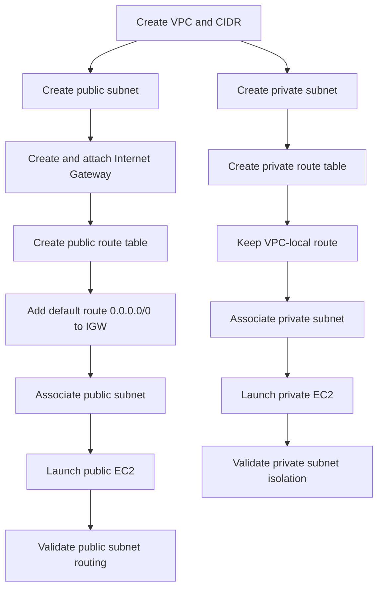

**Impact:** Provides a basic network foundation for placing public entry points separately from private application or database resources. A subnet is not public solely because it is named “public”; its route table and resource addressing/security configuration determine reachability.

### 3.2 Private EC2 access, NAT Gateway and S3 Gateway Endpoint

**Objective:** Connect to a private EC2 instance through a public EC2 instance, provide outbound access through NAT, and access S3 privately through a Gateway Endpoint.

**What I implemented / learned:** Used a public instance as the SSH jump point to reach a private instance over its private IP. The private instance initially had no outbound internet route. A NAT Gateway was created in the public subnet and the private route table was updated. A Gateway Endpoint was then configured for S3 and its route-table entry was verified.

**What this solves:** Supports controlled administration of private instances, outbound updates without direct inbound internet access, and private S3 access from the VPC.

**Flowchart:**

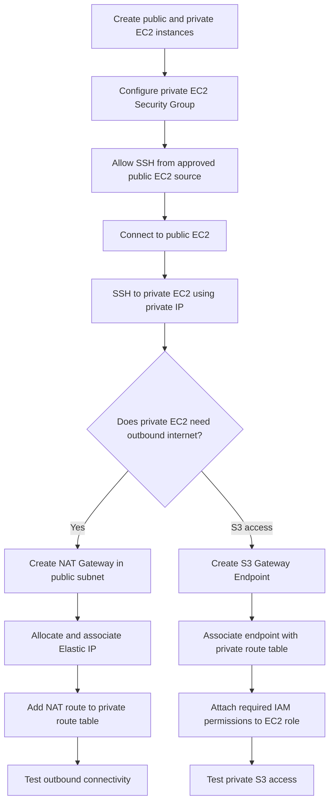

**Impact:** The private instance does not need a public IP for the documented SSH-through-public-instance workflow. NAT provides outbound connectivity; the S3 Gateway Endpoint provides a private route to S3. IAM permissions are still required for S3 API access.

### 3.3 HTTPS application with ALB, ACM and Route 53

**Objective:** Publish EC2-hosted application targets through an Application Load Balancer, configure HTTPS and route different hostnames to separate target groups.

**What I implemented / learned:** Created an ALB and EC2 target group, requested an ACM certificate, completed DNS validation through a Route 53 CNAME record, configured the HTTPS listener, created host-based routing rules and mapped the hostnames to their target groups.

**What this solves:** Gives users a DNS name and HTTPS entry point while routing requests to the correct backend target group.

**Flowchart:**

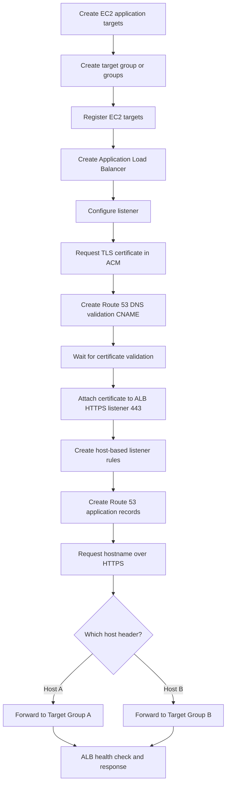

**Impact:** TLS is terminated at the ALB listener, and host-based rules direct requests to the right target group. Health checks help the ALB identify healthy targets. In the recorded exercise, the ALB accepted HTTPS traffic on port 443 and forwarded to EC2 targets on the configured target port.

### 3.4 EC2 Auto Scaling with CloudWatch

**Objective:** Create an Auto Scaling Group across two Availability Zones and test scale-out when CPU utilization rises.

**What I implemented / learned:** Created a Launch Template and an ASG with minimum capacity 1, desired capacity 2 and maximum capacity 3. Configured CPU-based scaling around the 50% threshold and generated CPU load on the instances to observe an additional instance being launched.

**What this solves:** Adjusts EC2 capacity based on demand and reduces the need to add or remove instances manually.

**Flowchart:**

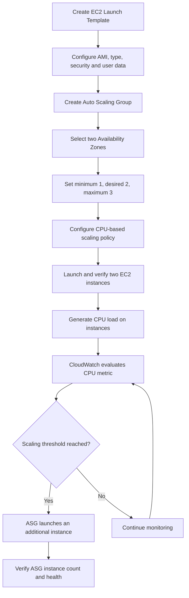

**Impact:** Demonstrates automated capacity adjustment based on workload metrics. ASG instance health checks and application health checks are different; the target group's health check should also be considered when the application must be evaluated.

### 3.5 S3 static website and bucket access policy

**Objective:** Host a simple static website from an S3 bucket and configure the bucket access policy used in the exercise.

**What I implemented / learned:** Prepared an `index.html` file and website assets, uploaded them to an S3 bucket, enabled static website hosting, selected the index document and configured a bucket policy to permit the intended website access.

**What this solves:** Shows how static content can be hosted from object storage without running a web server on EC2.

**Flowchart:**

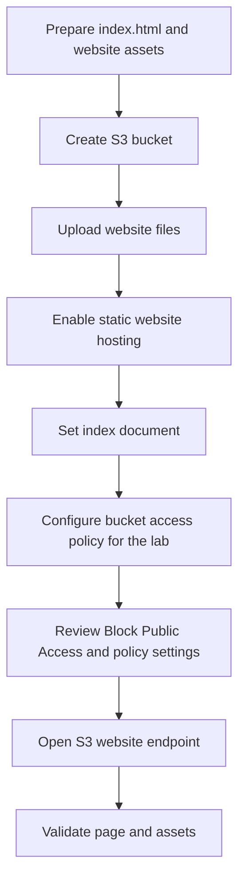

**Impact:** Demonstrates low-operations hosting for static assets. The exercise used bucket-policy access for testing. For production, do not disable public-access protections without an approved design; prefer private S3 access through CloudFront Origin Access Control where appropriate, and review HTTPS, logging and access requirements.

### 3.6 S3 event automation with EventBridge and Lambda

**Objective:** Trigger a Lambda function when an object event occurs in a selected S3 bucket.

**What I implemented / learned:** Created an S3 bucket, enabled EventBridge integration in the bucket properties, created an EventBridge rule to match the required bucket object event and configured Lambda as the target.

**What this solves:** Automates a follow-on action after an S3 event without requiring a continuously running server to poll the bucket.

**Flowchart:**

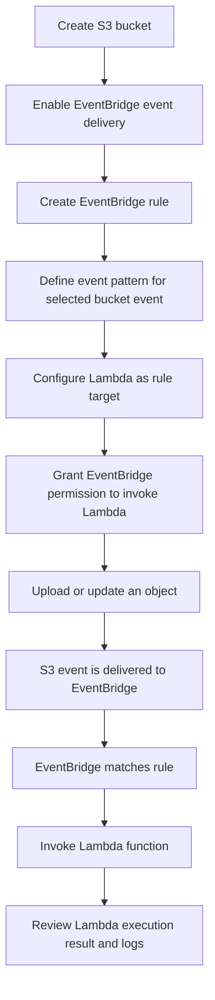

**Impact:** Creates an event-driven workflow that can process uploads, automate metadata handling or start downstream tasks. The event rule should be scoped to the intended bucket and event type to avoid unnecessary invocations.

### 3.7 Flask container deployment with ECR and ECS Fargate

**Objective:** Package a Flask application into a Docker image, store it in ECR and run it as an ECS service using Fargate.

**What I implemented / learned:** Prepared a Flask application, built a Docker image, pushed the image to ECR, created an ECS task definition, created an ECS cluster and service using Fargate, and verified that the task ran the application on port 8080. The notes also mention checking the application's health endpoint and logs.

**What this solves:** Deploys a containerized application on managed container capacity without manually managing the EC2 container hosts.

**Flowchart:**

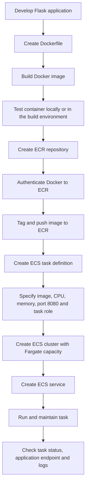

**Impact:** Demonstrates the container delivery path from application source to a running ECS task. Fargate reduces host management, while task definitions make container configuration repeatable. Application availability still depends on appropriate networking, health checks, permissions and service configuration.

### 3.8 Private EC2-to-RDS MySQL connectivity

**Objective:** Create an RDS MySQL database and connect to it from an EC2 instance while restricting database network access.

**What I implemented / learned:** Created an RDS MySQL instance, installed a MySQL client on EC2, configured the RDS Security Group to allow the database port from the EC2 Security Group, then connected using the RDS endpoint.

**What this solves:** Keeps database access limited to an approved application or administration host rather than exposing the database directly to the public internet.

**Flowchart:**

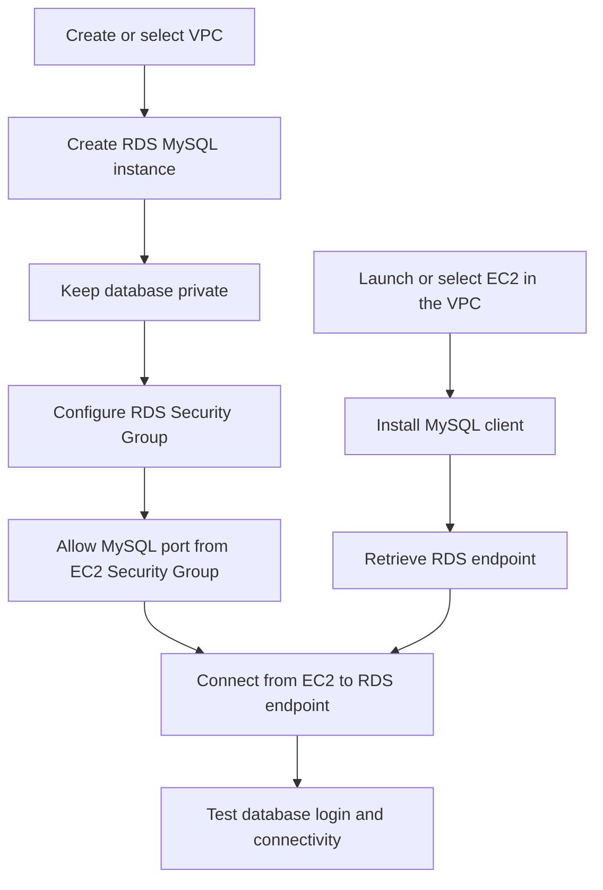

**Impact:** Demonstrates private database access and Security Group referencing. The database can accept traffic only from the configured source, subject to the VPC routing and other network controls.

### 3.9 CloudWatch Agent and VPC Flow Logs

**Objective:** Collect operating-system/application logs from EC2 and network-flow metadata from the VPC in CloudWatch Logs.

**What I implemented / learned:** For EC2 log collection, created and attached an IAM role, installed the CloudWatch Agent package, prepared its configuration and checked the agent status. For VPC Flow Logs, created a CloudWatch log group, configured the IAM delivery role and created the flow log with CloudWatch Logs as the destination.

**What this solves:** Centralizes host logs and VPC traffic metadata for troubleshooting and operational visibility.

**Flowchart A — EC2 CloudWatch Agent:**

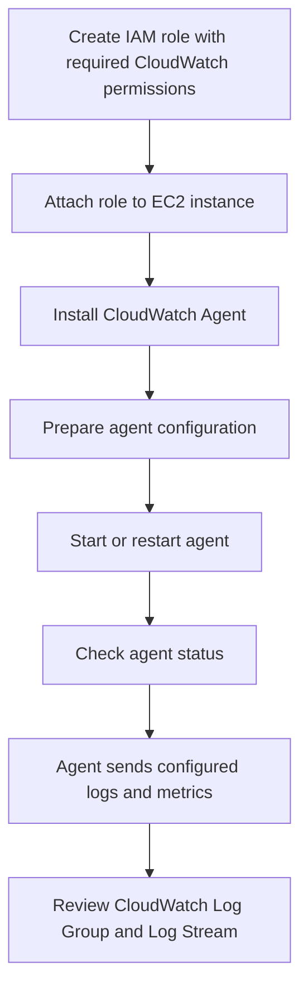

**Flowchart B — VPC Flow Logs:**

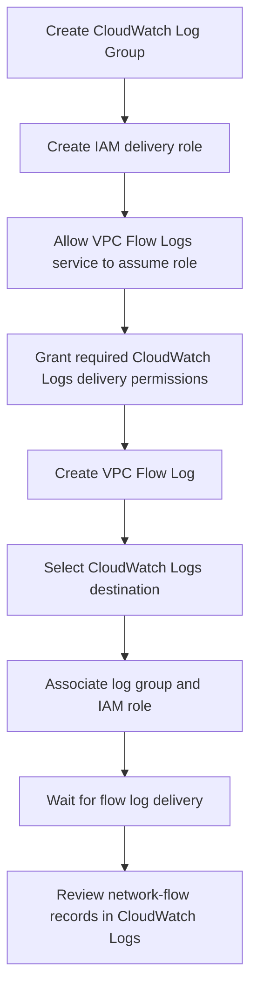

**Impact:** CloudWatch Agent provides host-level log and metric collection when configured. VPC Flow Logs provide network-flow metadata; they do not capture full packet payloads. These sources help investigate system and network issues from a central console.

---

## 4. EC2 Host Security: Fail2ban and msmtp

**Implementation summary:** Installed Fail2ban on an EC2 instance and configured msmtp to send email notifications.

### Problem addressed

Linux servers exposed to remote login attempts can receive repeated failed authentication attempts. Without host-level detection and response, administrators may have limited visibility into repeated failures and may need to inspect logs manually.

### Tools and their purpose

| Tool | Purpose | What I learned |
|---|---|---|
| Fail2ban | Monitors configured log sources and applies temporary bans when a filter/jail threshold is reached. | Learned how log monitoring, filters, jails, retry thresholds and ban durations work together to respond to repeated failed login attempts. |
| msmtp | Lightweight SMTP client that sends email through a configured mail provider. | Learned how a Linux host can send alert messages through an SMTP relay and how notification delivery depends on correct SMTP configuration and credentials. |

### Implementation workflow

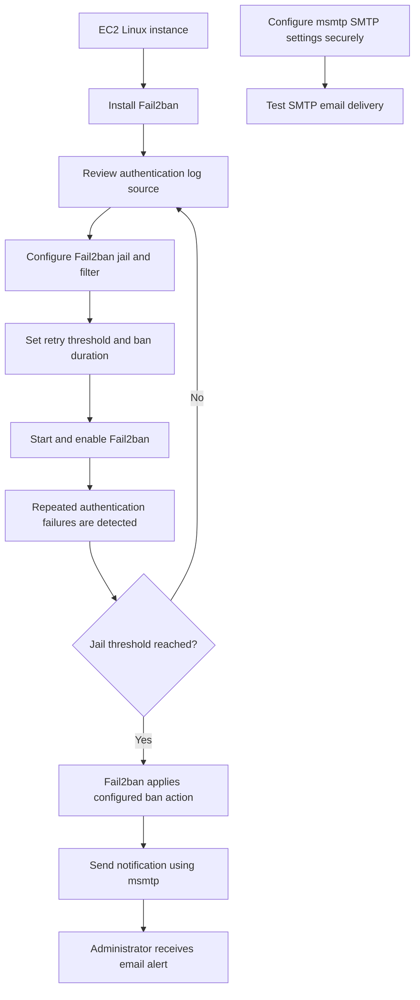

### What I learned

- How Fail2ban uses log entries and filters to identify repeated failed authentication attempts.
- How jails define the monitored service, retry threshold, observation window and ban duration.
- How a ban action can temporarily block an offending source according to the configured firewall action.
- How msmtp acts as an SMTP client for sending alert emails from a Linux host.
- How to test log detection, ban behavior, unban/recovery and email delivery.

## Fail2ban – Extra Notes

- Fail2ban can also help protect application APIs from brute-force attempts by monitoring application logs and temporarily banning IP addresses after repeated failed requests.
- This provides an additional layer of protection against repeated authentication attempts and suspicious activity.
- However, it is not a replacement for a dedicated API rate-limiting solution, which controls how many requests a client can make within a specific time period.

---

## 5. Centralized Infrastructure Monitoring: Nagios Core and NRPE

**Implementation summary:** Installed Nagios Core on a main EC2 instance, installed/configured NRPE and plugins on two additional EC2 instances, and configured email notifications for alerts based on monitoring states and thresholds.

### Problem addressed

When multiple EC2 instances are managed separately, it can be difficult to check host availability and service health from one place. A centralized monitoring server gives administrators a single view of configured hosts and checks.

### Tools and their purpose

| Tool | Purpose | What I learned |
|---|---|---|
| Nagios Core | Central monitoring engine that schedules checks, evaluates results and displays host/service states. | Learned how to define hosts, services, check intervals, thresholds, alert states and notification contacts. |
| NRPE | Allows the Nagios server to run approved checks on remote hosts through the NRPE agent/service. | Learned how a central monitoring server communicates with remote EC2 instances to execute local plugins. |
| Nagios Plugins | Scripts/programs that perform individual checks such as disk, load, memory or service checks. | Learned how plugins return status and output for Nagios to evaluate. |
| Email notification | Sends alerts when configured host or service state/notification conditions are met. | Learned how monitoring results can notify an operator instead of relying only on dashboard checks. |

### Architecture and monitoring workflow

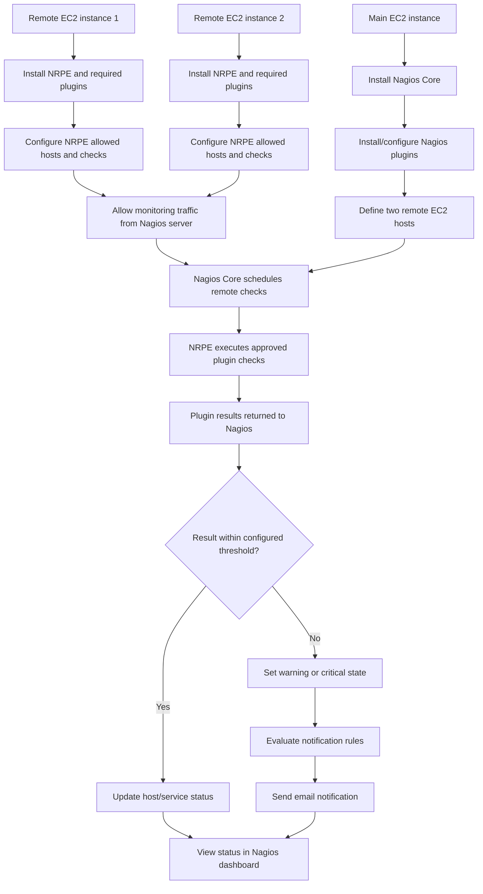

### What I learned

- How to install and configure Nagios Core on a central monitoring host.
- How to define remote EC2 instances as Nagios hosts.
- How NRPE allows Nagios to request checks from remote machines.
- How plugins report check results and how warning/critical thresholds are evaluated.
- How to configure email notifications for host/service alerts.
- Why network access, allowed-host configuration, plugin permissions and check definitions must match between the central and remote hosts.

### Use and operational impact

The setup provides centralized visibility into the two monitored EC2 instances and their configured host/service checks. When a check crosses its configured warning or critical threshold, Nagios can change the state and send an email notification based on the notification settings.

**Impact statement:** Centralized checks and notifications can reduce the time required to notice infrastructure issues and provide a starting point for troubleshooting. The actual coverage depends on which checks, thresholds, intervals and notification rules are configured. The report does not claim monitoring of metrics that were not configured or measured.

---

## 6. Other Practical Learning Summaries

These exercises are included briefly because the notes describe practical work, but they do not need separate full flowcharts in this report.

| Practical exercise | What I did / learned | Why it is useful |
|---|---|---|
| CloudFormation | Prepared a YAML template, uploaded it to S3 and used it to create a CloudFormation stack. | Repeats infrastructure deployments from a declared template and reduces manual console steps. |
| IAM role and policy | Created a user with limited permissions, created a role with a trust relationship and permission policy, and tested role switching. | Demonstrates separation of identity, trust and permissions; supports temporary, scoped access. |
| Systems Manager Session Manager | Attached the required IAM role to EC2 instances and used Session Manager to access managed instances without opening inbound SSH for the session path. | Provides centrally controlled access and reduces dependency on managing SSH keys and inbound port 22. |
| EC2 SSH key recovery | Practiced recovering access using EC2 Instance Connect and a helper EC2/EBS-volume method. | Provides recovery options if the original SSH private key is lost, subject to access and recovery prerequisites. |
| AWS Organizations and SCP | Created an organization/account structure and tested an SCP restriction on permitted EC2 instance types. | Demonstrates organization-level permission guardrails. An SCP sets the maximum available permissions; it does not grant permissions by itself. |
| IAM Identity Center | Enabled Identity Center, created a user and permission set, assigned it to an account and tested sign-in. | Centralizes user access to multiple AWS accounts through permission sets. |
| Billing alert and budget | Configured a billing alert with an SNS notification path and reviewed AWS Budgets and cost allocation tags. | Provides earlier visibility into estimated charges and helps categorize spend. |
| Route 53 private hosted zone | Created a private hosted zone and DNS record to resolve an EC2 host using an internal name from within the associated VPC. | Simplifies internal name resolution without exposing the record through public DNS. |
| Glue Crawler and Athena | Created an S3 location for CSV data, configured a Glue crawler and IAM access, then queried the cataloged data using Athena. | Useful for cataloguing files in S3 and querying them with SQL without setting up a separate database server. |

---

## 7. What I Learned Overall

The biggest thing I took away from this learning was how closely the AWS services are connected. A VPC and its route tables decide how resources communicate; IAM controls who can access or change them; load balancers and Auto Scaling help applications handle traffic; and monitoring tools show what is happening after everything is running. Working through the practical exercises made those relationships much clearer than studying the services separately.

I now have practical experience with:

- Creating a VPC with public and private subnets, route tables, an Internet Gateway, a NAT Gateway and an S3 Gateway Endpoint.
- Launching and managing EC2 instances, controlling access with Security Groups and IAM roles, and using different ways to recover or access an instance.
- Putting an application behind an HTTPS Application Load Balancer, using ACM certificates and Route 53 records, and routing requests by hostname.
- Testing EC2 Auto Scaling by generating CPU load and watching the Auto Scaling Group respond to CloudWatch metrics.
- Hosting a simple static website in S3 and connecting an S3 upload event to Lambda through EventBridge.
- Building a Flask container image, pushing it to ECR and running it as an ECS Fargate service.
- Connecting an EC2 instance to a private RDS MySQL database through Security Group rules.
- Sending EC2 logs and VPC Flow Logs to CloudWatch for easier troubleshooting.
- Adding Fail2ban and email alerts to an EC2 host, then setting up Nagios Core and NRPE to monitor two other EC2 instances from one place.

I also spent time with CloudFormation, IAM roles and policies, Systems Manager, AWS Organizations, billing alerts and cost tools. These topics helped me understand the administration around an AWS environment, not just how to launch resources.

Overall, I am more comfortable following an AWS setup from the network and access configuration through to deployment and monitoring. I still have more to practise, but I now have a useful base of notes and hands-on exercises that I can return to when working on similar environments.

---

## **8. What I'd Like to Work on Next** ##
[!IMPORTANT]
After spending time learning AWS and practising different services using my own AWS account, I'd like to start applying what I've learned to the team's environment and take on more hands-on work.

- **Take on more tasks:** I have some availability and would like to use that time productively. Please let me know where I can help or whether there are any pending tasks I could pick up.
- **Work on real project tasks:** The practical exercises have made me more confident working with AWS. I'd like the opportunity to contribute to real project work and gradually take on production-related tasks with the right guidance.
- **Understand the existing AWS environment:** It would be helpful to get the appropriate access to our AWS account so I can review the current infrastructure, understand how the services are connected, and assist with basic troubleshooting or debugging when needed. I'm happy to work with the access level and permissions you consider suitable.

I had also spoken to Yatin Sir and Kartik Sir about getting more involved in the actual work. I wanted to mention it here as well and check where I could start contributing.

---

## References

- [AWS Documentation](https://docs.aws.amazon.com/)
- [AWS Certified Solutions Architect – Associate](https://aws.amazon.com/certification/certified-solutions-architect-associate/)
- [Udemy SAA-C03 Course](https://www.udemy.com/course/new-aws-certified-solutions-architect-associate-saa-c03/)
- [Nagios Core Documentation](https://www.nagios.org/documentation/)
- [Fail2ban Documentation](https://github.com/fail2ban/fail2ban)
- [msmtp Documentation](https://marlam.de/msmtp/)

