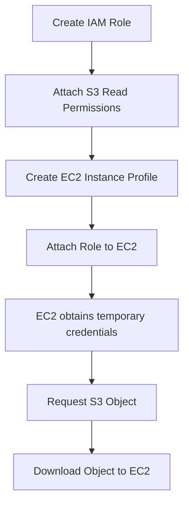

# EC2 and IAM Role-Based S3 Access

**Concept**
EC2 provides virtual machines in AWS. An IAM instance role gives an application or instance temporary permissions to access other AWS services without storing access keys on the server.

**What I worked on**
I launched an Ubuntu EC2 instance, connected to it, attached an IAM role, and used the instance to download an object from S3. I also created an AMI from the instance.

**How I did it**
- Launched an EC2 instance and allowed SSH access through its security group.
- Connected using SSH and EC2 Instance Connect.
- Attached an IAM role with the required S3 permissions.
- Tested access by downloading an S3 object from the instance.
- Created an AMI to reuse the instance configuration.

**Problem it solves**
This shows how to provide an EC2 workload with controlled AWS access without keeping long-lived access keys on the instance.

**Flowchart**
