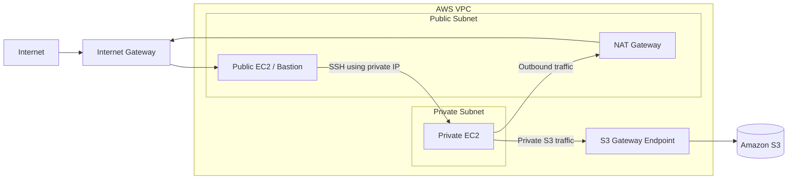

# VPC Public and Private Networking

**Concept**
- A VPC provides an isolated network for AWS resources.
- Subnets and route tables control where resources are placed and how their traffic moves.

**What I worked on**
- I created public and private subnets, connected to a private EC2 instance through a public EC2 host, configured outbound access through a NAT Gateway, and added an S3 Gateway Endpoint.

**How I did it**
- Created a VPC, subnets in separate Availability Zones, route tables and an Internet Gateway.
- Allowed SSH from the public host to the private instance using private addressing and security-group rules.
- Routed private-subnet internet-bound traffic through a NAT Gateway in a public subnet.
- Added an S3 Gateway Endpoint and its route-table entry for private S3 access.

**Problem it solves**
- Private instances can stay off the public internet while still receiving controlled administration access, downloading required updates, and reaching S3 privately.

**Flowchart**

