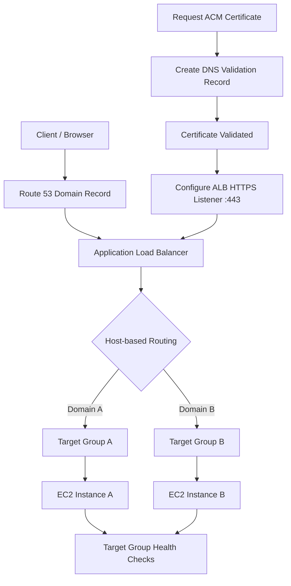

# Application Load Balancer with HTTPS and Host-Based Routing

**Concept**
An Application Load Balancer routes HTTP and HTTPS requests to target groups based on listener rules, including the hostname in a request.

**What I worked on**
I configured an ALB with EC2 target groups, added HTTPS using an ACM certificate, and routed two hostnames to separate target groups. I also tested load-balancer stickiness.

**How I did it**
- Created the ALB and target groups for the EC2 instances.
- Requested an ACM certificate and added the Route 53 DNS validation record.
- Attached the issued certificate to the ALB HTTPS listener.
- Created host-based listener rules and Route 53 records for the domains.
- Tested routing and configured a load-balancer-generated sticky session.

**Problem it solves**
One ALB can provide HTTPS access and route multiple domains or applications to the correct backend without exposing each EC2 instance directly.

**Flowchart**
