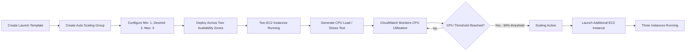

# EC2 Auto Scaling

**Concept**
- An Auto Scaling Group maintains EC2 capacity and can add or remove instances based on configured policies and metrics.

**What I worked on**
- I created an Auto Scaling Group across two Availability Zones using a launch template.
- The lab used a minimum of 1, desired capacity of 2, maximum of 3, and a CPU-based scaling trigger around 50%.

**How I did it**
- Created a launch template with the EC2 configuration.
- Created the Auto Scaling Group across two Availability Zones.
- Set the minimum, desired and maximum capacity.
- Configured CPU-based scaling through CloudWatch.
- Generated CPU load on the instances and observed the group scale out from two to three instances.

**Problem it solves**
- The group can add capacity when demand increases and reduce unused capacity when demand falls, instead of relying on manual instance changes.

**Flowchart**

