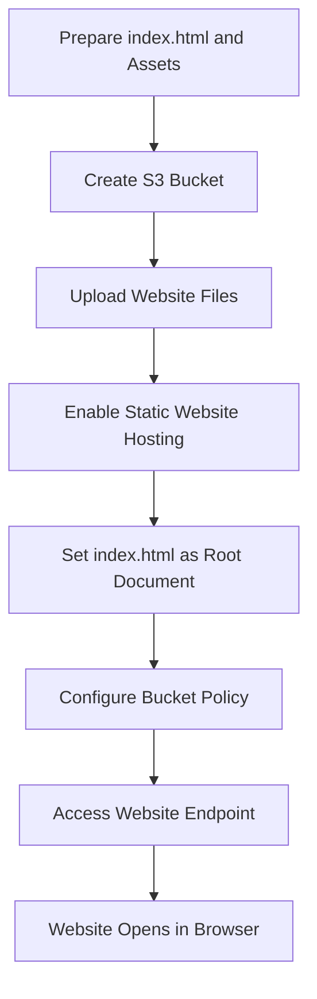
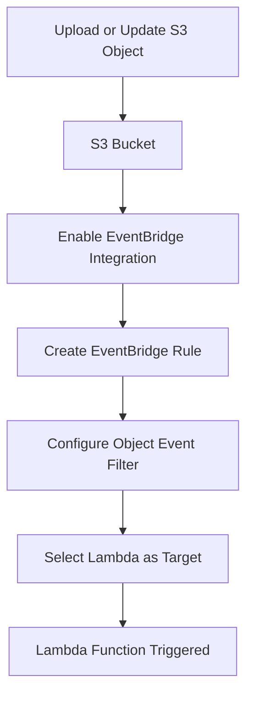

# S3 Static Website and EventBridge Automation

**Concept**
- S3 can host static website files.
- S3 events can also be routed through EventBridge to trigger actions in other AWS services.

**What I worked on**
- I hosted a basic website from an S3 bucket and configured an EventBridge rule to invoke a Lambda function when objects in the bucket were updated.

**How I did it**
- Uploaded an `index.html` file and its related assets to an S3 bucket.
- Enabled static website hosting and set the index document.
- Configured the bucket's EventBridge integration.
- Created an EventBridge rule for the bucket event and selected a Lambda function as the target.
- Tested the rule by updating an object in the bucket.

**Problem it solves**
- The website exercise demonstrates hosting static content without managing a web server.
- The event workflow demonstrates how an upload or object change can start automated processing without a continuously running server.

**Flowchart**
### 1. S3 static website hosting

### 2. S3 event triggering Lambda

