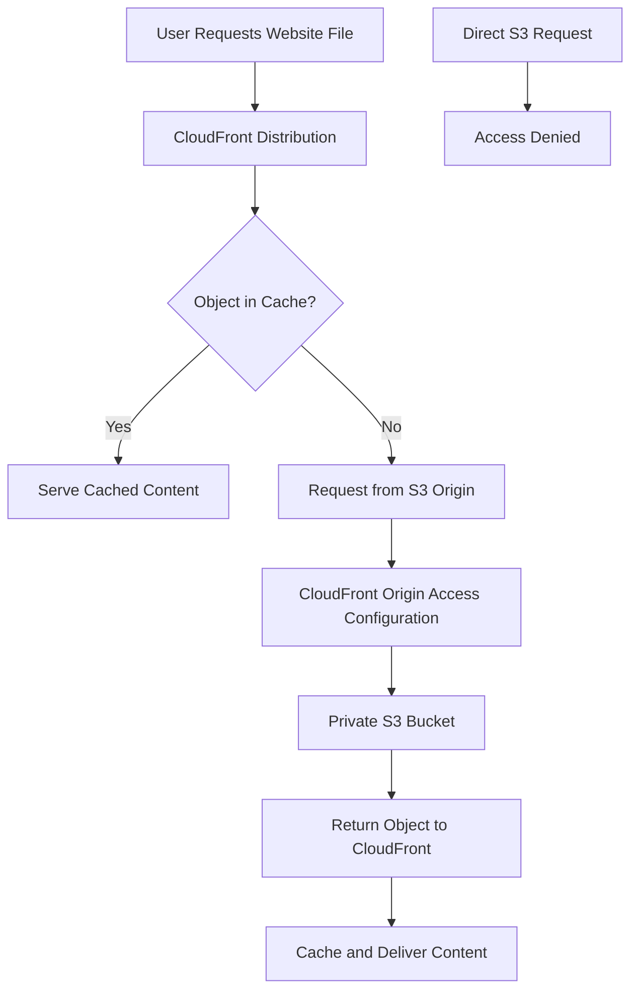

# CloudFront with a Private S3 Origin

**Concept**
CloudFront caches content at edge locations. Origin Access Control (OAC) lets a CloudFront distribution access an S3 origin while keeping direct bucket access restricted.

**What I worked on**
I created a private S3 bucket and connected it to a CloudFront distribution as the origin. I configured access so the content could be served through CloudFront rather than directly from the bucket.

**How I did it**
- Created an S3 bucket with public access blocked.
- Created a CloudFront distribution using the bucket as its origin.
- Configured Origin Access Control and the bucket permission for the distribution.
- Tested access through the CloudFront distribution and checked that direct bucket access remained restricted.

**Problem it solves**
This provides cached delivery for static content while reducing direct exposure of the S3 bucket.

**Flowchart**
