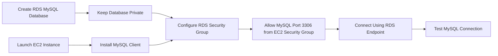

# EC2 Connection to a Private RDS MySQL Database

**Concept**
- RDS provides a managed relational database.
- A private database can accept connections from approved workloads inside the VPC without being publicly accessible.

**What I worked on**
- I created an RDS MySQL database with public access disabled and connected to it from an EC2 instance.

**How I did it**
- Created the RDS MySQL database in the VPC.
- Installed a MySQL client on the EC2 instance.
- Updated the RDS security group to allow the database port from the EC2 security group.
- Connected using the RDS endpoint and database credentials.

**Problem it solves**
- The application server can communicate with its database over the VPC network while the database remains unavailable for direct public connections.

**Flowchart**

