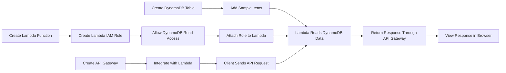

# API Using Lambda and DynamoDB

**Concept**
- DynamoDB stores application data in a managed NoSQL table.
- Lambda can read that data, and API Gateway can expose the function through an HTTP API.

**What I worked on**
- I created a DynamoDB table and sample items, wrote a Lambda function to read the table, and exposed the function through API Gateway.

**How I did it**
- Created a DynamoDB table with its key configuration and added items.
- Created a Lambda function to retrieve data from the table.
- Attached an execution role with logging and the required DynamoDB read permission.
- Created an API Gateway endpoint integrated with the Lambda function.
- Tested the endpoint from a browser.

**Problem it solves**
- This pattern exposes data through an API without running a dedicated application server or managing database infrastructure.

**Flowchart**

