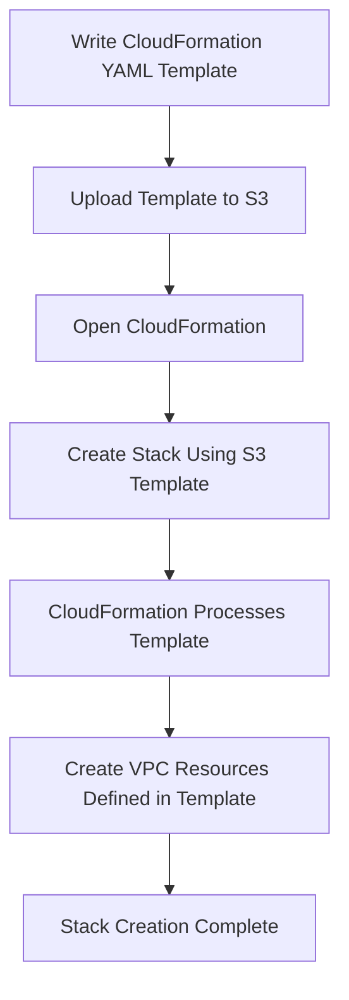

# VPC Deployment with CloudFormation

**Concept**
- CloudFormation creates AWS resources from a declarative YAML or JSON template, making infrastructure configuration repeatable.

**What I worked on**
- I used a YAML CloudFormation template to create a VPC stack.

**How I did it**
- Prepared the CloudFormation YAML template.
- Uploaded the template to an S3 bucket.
- Created a CloudFormation stack using the template stored in S3.
- Checked the stack status and the resources created by the stack.

**Problem it solves**
- A template provides a repeatable way to create infrastructure and reduces manual configuration differences between environments.

**Flowchart**

