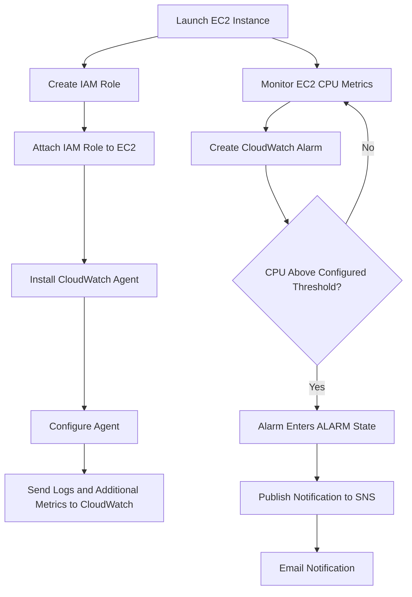

# EC2 Monitoring with CloudWatch

**Concept**
CloudWatch collects metrics and logs, and alarms can trigger actions or notifications when a metric crosses a configured threshold. The CloudWatch Agent collects additional metrics and instance logs.

**What I worked on**
I installed the CloudWatch Agent on an EC2 instance and created a CloudWatch alarm for high EC2 CPU utilization with an SNS notification path.

**How I did it**
- Created and attached an IAM role with permissions for the agent.
- Installed the CloudWatch Agent package on the EC2 instance.
- Applied the agent configuration and checked that the service was running.
- Created an SNS topic and a CloudWatch alarm for CPU utilization.
- Generated CPU load and checked that the alarm entered the alarm state.

**Problem it solves**
It provides visibility into instance activity and can notify an operator when monitored resource usage reaches a configured threshold.

**Flowchart**
