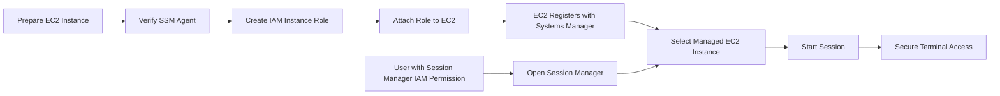

# EC2 Access with Systems Manager Session Manager

**Concept**
- Systems Manager Session Manager provides browser or CLI access to managed EC2 instances without requiring an inbound SSH connection.

**What I worked on**
- I worked through the setup required to connect to EC2 using Session Manager, including the SSM Agent and instance permissions.

**How I did it**
- Ensured the instance had the SSM Agent and an IAM role with the required Systems Manager permissions.
- Checked that the instance could reach the Systems Manager service endpoints.
- Started a Session Manager session to access the instance.
- Reviewed VPC endpoints as an option for private instances without NAT-based internet access.

**Problem it solves**
- It provides a managed administration path for private instances and can reduce the need to expose SSH or maintain inbound port 22 access.

**Flowchart**

