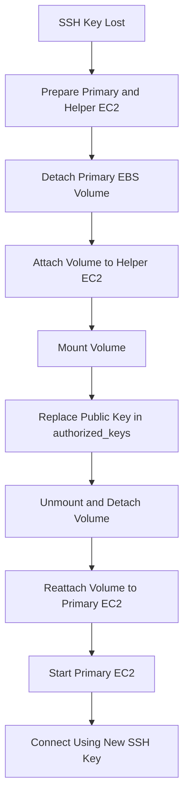

# EC2 SSH Key Recovery

**Concept**
EC2 key pairs are used for SSH access to Linux instances. If the configured public key is no longer available, access can be recovered through an alternate access path or by updating the authorized keys on the instance.

**What I worked on**
I practised recovering access with EC2 Instance Connect and replacing the public key. I also worked through a helper-instance method using the affected instance's EBS volume.

**How I did it**
- Used EC2 Instance Connect to access the instance through a temporary key.
- Created a replacement key pair and updated the public key in the instance's `authorized_keys` file.
- For the volume-based method, attached the affected root EBS volume to a helper instance, updated the key, then reattached the volume.
- Tested SSH access with the replacement key.

**Problem it solves**
It provides recovery options when an administrator loses the original SSH key, avoiding an unnecessary rebuild of the instance.

**Flowchart**
### 1. Recover access using EC2 Instance Connect

### 2. Recover access using a helper EC2 and EBS

