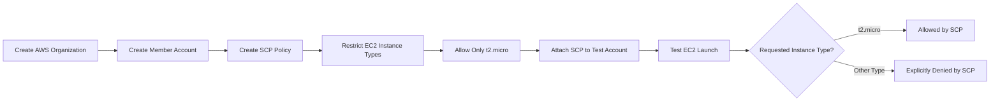
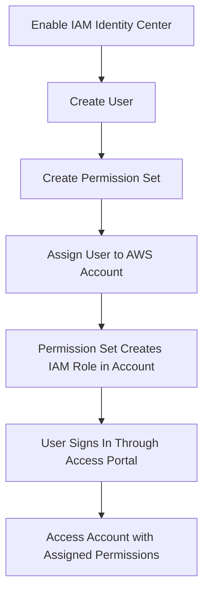

# IAM, AWS Organizations and Service Control Policies

**Concept**
- IAM policies define permissions for identities and resources.
- AWS Organizations manages multiple accounts, and Service Control Policies (SCPs) set the maximum permissions available in member accounts.

**What I worked on**
- I created an Organization and a member account, applied an SCP restricting EC2 instance types in a test account, and set up an IAM Identity Center user with a limited permission set.

**How I did it**
- Created the Organization and added a member account.
- Created and attached an SCP that restricted the test account to the selected EC2 instance type.
- Enabled IAM Identity Center, created a user and permission set, and assigned access to the account.

**Problem it solves**
- These controls help manage access across accounts and apply guardrails centrally.
- An SCP limits what identities can do; it does not grant permissions by itself.

**Flowchart**
### 1. AWS Organizations and SCP

### 2. IAM Identity Center

