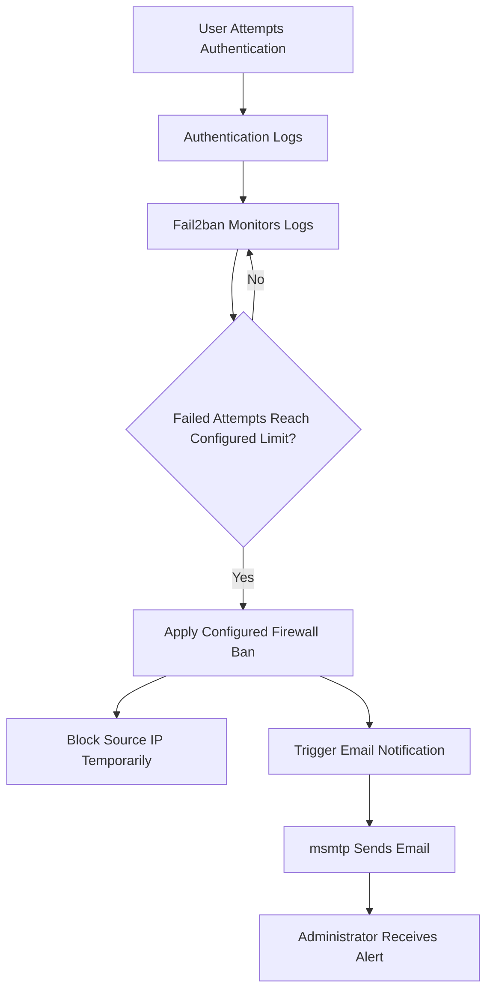

# EC2 Login Protection with Fail2ban

**Concept**
Fail2ban monitors log files for repeated authentication failures and can temporarily block source IP addresses through a configured firewall action.

**What I worked on**
I configured Fail2ban for host-level login protection and used msmtp as the SMTP client for email notifications.

**How I did it**
- Configured a Fail2ban filter and jail to watch the relevant authentication log.
- Set the retry count, observation window and ban duration.
- Configured the firewall action used when the threshold is reached.
- Set up the notification action to send email through msmtp.

**Problem it solves**
It automates a response to repeated login attempts and reduces the need to watch authentication logs manually. It is host-level protection, not a replacement for application API rate limiting or strong access controls.

**Flowchart**
