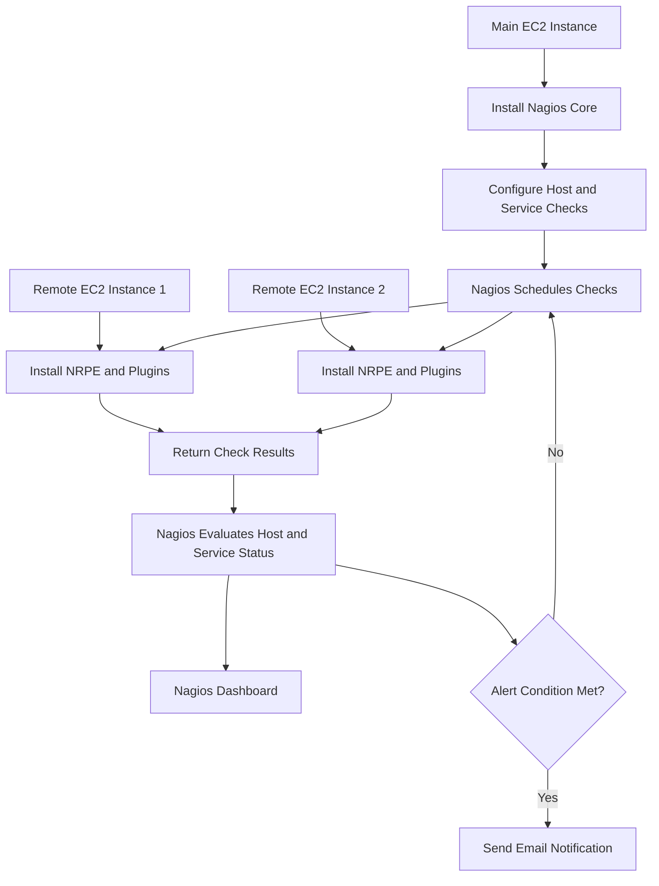

# Centralized EC2 Monitoring with Nagios Core and NRPE

**Concept**
Nagios Core provides centralized host and service monitoring. NRPE allows approved checks to run on remote Linux hosts and return their results to the monitoring server.

**What I worked on**
I set up Nagios Core on a main EC2 instance and configured NRPE with monitoring plugins on two additional EC2 instances.

**How I did it**
- Installed Nagios Core on the monitoring instance.
- Installed NRPE and the required plugins on the two monitored instances.
- Configured the remote hosts and service checks in Nagios.
- Set up notification rules and email alerts for monitored states.

**Problem it solves**
It provides one place to review the health checks configured for multiple EC2 instances and helps alert an operator when a host or service check reports a problem.

**Flowchart**
