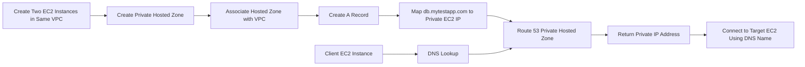

# Route 53 Private DNS

**Concept**
- A Route 53 private hosted zone resolves DNS names only within the VPCs associated with that hosted zone.

**What I worked on**
- I created a private hosted zone, associated it with a VPC, and configured a record for an internal resource.

**How I did it**
- Created the private hosted zone using the internal domain name.
- Associated the zone with the target VPC.
- Added a DNS record pointing to the resource's private address.
- Tested name resolution from an instance in the associated VPC.

**Problem it solves**
- Applications and administrators can use internal DNS names instead of relying on instance IP addresses or exposing internal resources through public DNS.

**Flowchart**

