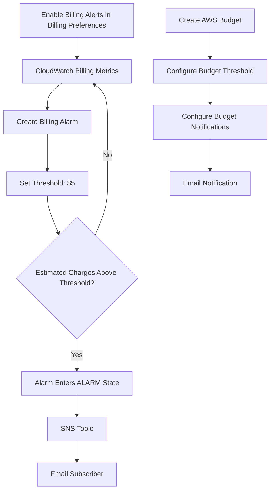

# AWS Billing Alerts and Budgets

**Concept**
CloudWatch billing alarms and AWS Budgets help track cloud spending and notify account owners when configured cost thresholds are reached.

**What I worked on**
I created a billing alarm for a $5 threshold with an SNS email notification and configured an AWS Budget.

**How I did it**
- Created an SNS topic and configured the email subscription.
- Created a CloudWatch billing alarm using the billing metric.
- Set the alarm threshold to $5 and connected it to the SNS topic.
- Created an AWS Budget to track account spending.

**Problem it solves**
Cost alerts provide an early warning when spending reaches a chosen limit and help avoid unexpected charges during hands-on testing.

**Flowchart**
